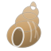

#+title: whelk
#+subtitle: a Wayland shell whose configuration is a Scheme program
#+author: Josep Jesus Bigorra Algaba
#+email: jjbigorra@gmail.com
#+language: en
#+options: toc:nil num:nil html-style:nil
#+HTML_HEAD: <link rel="stylesheet" type="text/css" href="https://jointhefreeworld.org/static/css/jointhefreeworld.css" />

[[https://jointhefreeworld.org/ggg/dist/lang-c.svg]] [[https://jointhefreeworld.org/ggg/dist/gtk4.svg]] [[https://jointhefreeworld.org/ggg/dist/scheme-guile.svg]] [[https://jointhefreeworld.org/ggg/dist/build-meson.svg]] [[https://jointhefreeworld.org/ggg/dist/gnu-guix.svg]] [[https://jointhefreeworld.org/ggg/dist/maak.svg]]
[[https://github.com/jjba23/whelk/actions/workflows/ci.yml/badge.svg]] [[https://img.shields.io/badge/license-MIT-2ea44f.svg]] [[https://jointhefreeworld.org/ggg/dist/jointhefreeworld-org.svg]]

#+attr_html: :width 128 :alt the whelk logo: a whelk shell drawn in SVG

#+begin_quote
An ordinary status bar is a compiled artefact with a settings file in front of
it.  whelk is a shell written in C, and the bar on screen is the value of a Guile
program you can rewrite while it runs.
#+end_quote

whelk is a *Wayland shell*: status bar, launcher, search, notification daemon, HUD, Wi-Fi, Bluetooth, notification centre, floating desktop widgets and more.  It is written in C with [[https://gtk.org/][GTK4]] and =gtk4-layer-shell=, and it is configured declaratively in Lisp: *[[https://www.gnu.org/software/guile/][GNU Guile Scheme]]* --
in S-expressions, rather than in JSON plus a CSS file.

It's a programmable flexible shell you can *program*: modules are values, a bar is a list, the settings file is
evaluated rather than parsed, and the REPL in the running shell is the same
environment the configuration lives in.

- 🐚 *Read the source, file an issue, send a PR:*
  [[https://github.com/jjba23/whelk][github.com/jjba23/whelk]]
- 📦 *Install it:* from the [[https://github.com/jjba23/guix-jointhefreeworld][jointhefreeworld Guix channel]], with Nix, with
  Meson, or from the =packaging/= recipes
- 📚 *Hack on it:* [[file:docs/development.org][the development guide]] for the conventions, the tests and the house rules
- 📰 *Follow what changed:* [[file:NEWS.org][the news]]
- 🤖 *Know the rules of the road:* [[file:AI_POLICY.md][the AI policy]]
- ☕ *Support the work:* [[https://bmc.link/jjbigorra][buying me a cup of coffee]]

#+TOC: headlines 2

------------------

* What whelk is
:PROPERTIES:
:CUSTOM_ID: what
:END:

A shell is the layer between you and the session: it tells you what the machine
is doing, and it is where you ask for things.  whelk does that with one binary.

| You have                    | whelk gives you                                            |
|-----------------------------+------------------------------------------------------------|
| niri, sway, Hyprland, river, an X11 desktop | a bar that docks itself, reserves its edge and stays out of the way |
| a Waybar =config.jsonc=       | a =settings.scm= that is evaluated, not parsed               |
| a =style.css=                 | bar keys for colour, font and radius, plus =#:css= for the rest |
| nm-applet, Blueman          | a Wi-Fi and Bluetooth panel behind the bar's own modules    |
| a menu bar on Wayland       | the focused application's own menus, where a menu bar puts them |

Saving the settings file rebuilds the bar in place -- no restart, no relogin.
Everything else (the panels, the launcher, the notification centre) is the same
kind of surface as a bar, so the next thing whelk grows does not have to
re-learn layer-shell.

* A first look
:PROPERTIES:
:CUSTOM_ID: first-look
:END:

#+name: whelk-bar
#+caption: An earlier 0.7 capture of the built-in (default-bar).  0.8 folded the shell menu and the focused window into the application-name menu, and this build keeps the shell menu behind the whelk, followed by the application's File/Edit/View; the window's name is an optional window-module, not part of the default bar.  Captured from a 1920x1080 X server with the stock defaults; the focused window is a small demo application and the Wi-Fi reading a stand-in, so the picture carries nothing from the machine it was taken on.

The left half says *whose window you are in and what can be done to it*; the
right half is the machine's own condition, one reading per module.  A bar with
no settings file at all looks like this, because whelk's built-in default *is*
the documented one -- see [[file:docs/configuration.org][Configuration]].

* Features
:PROPERTIES:
:CUSTOM_ID: features
:END:

- *A bar that is a data structure.* A bar is a name, an edge, a thickness and
  three lists of modules.  Every colour, font and radius is optional, so a bare
  =(bar)= is still readable; see [[file:docs/configuration.org][the bar keys]].
- *Desktop widgets, also data.*  The standard macOS Golden Gate cards -- Clock,
  Calendar, Weather, Batteries, Notes, Reminders, World Clock and Stocks -- are
  floating GTK4 surfaces described by =(desktop-widget ...)= records.  Weather
  and Stocks fetch live data; every card can be moved, resized, restyled or
  replaced by a command-backed =custom= widget from =settings.scm=; see
  [[file:docs/widgets.org][Desktop widgets]].
- *Twenty-two module kinds, one shape.* Clock, CPU, memory, battery, backlight,
  audio, power profile, workspaces, focused window, keyboard layout, Caps Lock,
  Wi-Fi, Bluetooth, notifications, do not disturb, the clipboard, tray, the
  shell menu, the global menu, =custom-module=, and =scheme-module= for a Guile
  procedure that returns a widget.  All of them take the same keyword options:
  an icon, a format, an interval, a tooltip and six mouse actions.
- *The configuration is a program.* =settings.scm= is evaluated, not parsed:
  bars can be built with =map=, a module list can be computed, and a settings
  file may define procedures of its own.
- *Hot reload, and a REPL.* The settings directory is watched; saving rebuilds
  every bar.  Ask for a socket REPL and evaluate forms in the running shell.
- *A menu bar's left half, in macOS' order.* The machine's own menu behind the
  whelk (where the apple is), then that application's =File=/=Edit=/=View=.
  The shell menu is configuration --
  =About This System=, =Control Panel=, =Software=, a live =Recent Items=
  submenu, =Force Quit=, sleep/restart/shut down, lock and log out, then the
  launcher, a reload and the way out -- written with =(menu-item ...)=,
  =(menu-separator)= and =(menu-submenu ...)= in the settings file, so it is a
  value a reload away from being on screen.  The network, Bluetooth and
  notification panels have their own modules, CLI flags and keybindings and do
  not need a second home in the session menu.
- *The focused application's menus, from six producers.* Its own
  =File=/=Edit=/=View= where it publishes a menubar over D-Bus -- both
  =org.gtk.Menus= (GTK) and =com.canonical.dbusmenu= (Qt, KDE, appmenu
  registrars) -- else the same tree read through AT-SPI, the accessibility bus
  GTK, Qt and Electron applications already expose; else a command the
  configuration names, else the documented shortcuts of ninety-five
  applications, each entry showing its chord and typing it; File also carries
  =Close Window= and =New Window= from the desktop entry's =Exec= whenever it
  has one; and =Window= holds the compositor's arranging verbs -- maximize,
  float, move and full screen.  Emacs multi-key chords such as =C-x C-s= are
  sequences, shown and typed chord by chord.  Never an invented menu.
- *A tray that shows what is running.* StatusNotifierItems -- JetBrains
  Toolbox, network applets, chat clients -- over the standard
  =RegisteredStatusNotifierItems= list, with a chevron for icons beyond
  =#:max-items=, and each icon's own =com.canonical.dbusmenu= context menu in a
  whelk popover: =AboutToShow= first, then =GetLayout=, then =Event(id,
  "clicked")= for the row chosen.  An applet's =IconThemePath= is searched
  before the desktop icon theme, so an app that ships a colour icon does not
  turn into a black monochrome glyph on a dark bar.
- *A HUD for the two dials.* A volume or brightness change raises a small
  bottom-centre card with the glyph, the reading's name, a bar and the number,
  then takes it away -- the macOS answer, drawn by the shell rather than by two
  modules that would each draw their own.  It wears the bar's palette and
  accent, so it belongs to the same desktop.
- *A clipboard history with an off switch.* =wl-paste --watch= feeds a
  de-duplicated list of text, rich text, images and copied files; =whelk
  --clipboard= (or the =;= prefix) puts any copy back, and the default bar's
  =clipboard-module= opens that picker on a click and its history controls on a
  right click.  Entries can be pinned (=Ctrl+P=), deleted (=Ctrl+Delete=, with
  =Ctrl+Z= to undo), paused, cleared or expired; a password manager's secret
  hint is honoured.  Memory is bounded, persistence is opt-in and can be a
  pinned-only vault, and the whole history can be cleared when the session
  locks.
- *A menu bar you can search.* =whelk --launcher-mode=menuitem= (prefix =:=)
  lists every entry of the focused application's live menus with its path and
  chord -- the Help menu's search field, for menus that came from GTK,
  DBusMenu, a script or the dictionary -- and choosing one does what clicking
  it in the bar does.
- *An About window that describes the machine.* =About This System= opens an
  opaque card with the host name, system, processor model and thread count,
  memory (total and available), display, disk (free, total and used percent),
  kernel, session and protocol, and uptime.  The whole report is one Ctrl+C or
  one Copy away, and a Settings button goes straight to whelk's own window.
- *A right half that folds instead of overflowing.* When the readings no
  longer fit, the trailing modules move behind a =+N= count and keep updating
  and clicking there.  A bar can also keep a deliberate shelf: modules named by
  =#:overflow= sit behind the row's one chevron and open horizontally on a
  click, closed by default.
- *A notification daemon.* whelk owns =org.freedesktop.Notifications= when
  nothing else does: toasts top right, a centre grouped by application, actions
  as buttons, persistence, and do-not-disturb.
- *The network where the applets were.* Wi-Fi access points with signal and a
  lock, a radio switch, a rescan, a password prompt in the panel itself, and
  Bluetooth pairing state -- all through =nmcli= and =bluetoothctl=, the
  scripting surface those projects ship.
- *A launcher, not a second program.* Applications, windows, commands with
  =$PATH= completion, arithmetic, files, the web, ssh hosts, closing a window
  and menus a command generates -- its script protocol, icons and rows that are
  shown but never chosen -- in one overlay with one fuzzy matcher.  The card
  resizes from its lower-right grip, and its Icons and Text buttons zoom without
  changing the bar's own typography.
- *Twelve themes, and no borrowed marks.* =glass-2001= through =tinted-2024=,
  plus =frost=, =ember=, =mocha=, =midnight=, =sandstone= and =void=: materials
  and years, not products.  The built-in bar wears =gloss-2007=: dark graphite
  glass, a highlight across the top, and a square, black-hairlined menu bar.
- *Sessions are asked, not assumed.* niri, sway, Hyprland, river and X11 each
  get their own integration; what a session cannot do goes quiet, with one line
  in the log saying why, instead of an error per frame.  Hyprland answers over
  =hyprctl=, JSON like niri's, including its workspaces and the active workspace
  on each monitor.  river answers over =riverctl= for the window actions it can
  carry out, and its focused view arrives as a push on the =river-status=
  Wayland protocol; whelk binds that protocol over its own connection.  River
  publishes the title there, not an application id, so ={app-id}= stays empty
  rather than being guessed.
- *Boring where it counts.* =-Werror=, unit tests for the pure halves, a Guile
  suite that pins the built-in bar, a hermetic Guix build, and CI that runs the
  same task you do.

* Quick start
:PROPERTIES:
:CUSTOM_ID: quick-start
:END:

Five commands and you are looking at your own bar:

#+begin_src sh
  guix install whelk
  mkdir -p ~/.config/whelk
  cp settings/settings.scm ~/.config/whelk/settings.scm
  whelk &            # or: whelk --quit, to replace a running one
  $EDITOR ~/.config/whelk/settings.scm
#+end_src

Save the file and the bar changes; move a module from =#:right= to =#:left=
and save again, and it moves.  With no settings file at all you get the built-in
default bar, so the first start is never a blank screen.

[[file:docs/getting-started.org][Getting started]] continues from there: what the first screen is made of, what to
click, and the command line a keybinding uses to open a surface.

* Install
:PROPERTIES:
:CUSTOM_ID: install
:END:

| Route                    | Command                                                              |
|--------------------------+----------------------------------------------------------------------|
| the jointhefreeworld channel | =guix install whelk=, from [[https://github.com/jjba23/guix-jointhefreeworld][the channel]]                        |
| Nix                      | =nix-build -E 'with import <nixpkgs> {}; callPackage ./default.nix {}'= |
| from source              | =meson setup build && ninja -C build && meson test -C build=           |
| a distribution package   | =maak deb-build=, =maak arch-build=, =maak rpm-build=                   |

[[file:docs/installation.org][Installation]] has the requirements, what the binary links (and why PAM is not on
that list), the run-time tools whelk asks for, and how to stop a running shell.

* Documentation
:PROPERTIES:
:CUSTOM_ID: documentation
:END:

The manual lives in [[file:docs/index.org][docs/]], one document per subject.  The
[[file:docs/index.org][index]] also has three reading paths -- using it, hacking on it, and something is
wrong.

| Document                                   | Answers                                                    |
|--------------------------------------------+------------------------------------------------------------|
| [[file:docs/getting-started.org][Getting started]]                            | first bar, first clicks, talking to the running shell      |
| [[file:docs/installation.org][Installation]]                               | requirements, linkage, Guix, Nix, packages, starting       |
| [[file:docs/configuration.org][Configuration]]                              | =settings.scm=, bar keys, GUI overrides, presets, the REPL   |
| [[file:docs/modules.org][Modules]]                                    | the module kinds and the options they take                 |
| [[file:docs/widgets.org][Desktop widgets]]                            | the Golden Gate cards, placement, dragging                 |
| [[file:docs/themes.org][Themes]]                                     | the twelve palettes                                       |
| [[file:docs/menus.org][Menus]]                                      | the shell menu and the global menu                         |
| [[file:docs/launcher.org][The launcher]]                               | the eleven modes, geometry, the menu script protocol       |
| [[file:docs/clipboard.org][The clipboard]]                              | what is stored, memory, persistence, locking               |
| [[file:docs/notifications.org][Notifications]]                              | the daemon, toasts, the centre, do-not-disturb             |
| [[file:docs/network.org][The network panel]]                          | Wi-Fi and Bluetooth through nmcli and bluetoothctl         |
| [[file:docs/tray.org][The tray]]                                   | StatusNotifierItems and their own menus                    |
| [[file:docs/lock-screen.org][The lock screen]]                            | the session lock, the fallback, PAM, every failure message |
| [[file:docs/idle.org][Idle, inhibitors, DND]]                      | the one idle timer and why the screen blanked              |
| [[file:docs/sessions.org][Sessions]]                                  | niri, sway, Hyprland, river, X11: what each one can do     |
| [[file:docs/parity.org][Parity with Waybar]]                        | the reference bar, module by module                        |
| [[file:docs/architecture.org][Architecture]]                              | the source tree, the Scheme boundary, how a bar is drawn   |
| [[file:docs/lifecycle.org][Lifecycles]]                                | startup, reload, refresh, lock, shutdown                   |
| [[file:docs/development.org][Development]]                               | =maak=, tests, CI, house rules                               |
| [[file:docs/releasing.org][Releasing]]                                 | version agreement and what =publish= does                    |
| [[file:docs/packaging.org][Packaging]]                                 | the three recipes and the installed layout                 |
| [[file:docs/known-limits.org][Known limits]]                               | what whelk deliberately cannot do                          |
| [[file:docs/roadmap.org][Status and roadmap]]                        | what works today and what comes next                       |
| [[file:docs/contributing.org][Contributing]]                              | bug reports, patches, new modules                           |

* Status and roadmap
:PROPERTIES:
:CUSTOM_ID: status
:END:

The shell is usable every day: the bar, its twenty-two module kinds, the
launcher, notifications, the network panel, the clipboard, the lock screen, the
idle manager and the desktop widgets all work, on the sessions that support
them.  [[file:docs/roadmap.org][Status and roadmap]] has the table and the next pieces,
[[file:docs/known-limits.org][known limits]] has the honest ceilings, and [[file:NEWS.org][NEWS.org]] has the history
release by release.

* License
:PROPERTIES:
:CUSTOM_ID: license
:END:

whelk and all of its source code are free software, licensed under the
[[https://opensource.org/license/mit][MIT License]].  The documentation and the
examples, including this document, are under the same licence.

The full text ships with the project in [[file:LICENSE][LICENSE]].

#+begin_quote
Copyright © Josep Bigorra <jjbigorra@gmail.com>
#+end_quote

------------------

* About this project
:PROPERTIES:
:CUSTOM_ID: about
:END:

- 🐚 *Read the source:* [[https://github.com/jjba23/whelk][github.com/jjba23/whelk]]
- 📰 *Read the news:* [[file:NEWS.org][NEWS.org]]
- 📚 *Read the manual:* [[file:docs/index.org][docs/]]
- 🤖 *Know the rules of the road:* [[file:AI_POLICY.md][AI_POLICY.md]]
- 📦 *Install from the channel:* [[https://github.com/jjba23/guix-jointhefreeworld][guix-jointhefreeworld]]
- ☕ *Support the work:* [[https://bmc.link/jjbigorra][buying me a cup of coffee]]

~whelk~ is part of the [[https://jointhefreeworld.org/][jointhefreeworld]] family of small, readable,
self-hostable free software, alongside
[[https://codeberg.org/jjba23/byggsteg][byggsteg]],
[[https://github.com/jjba23/lambdock][lambdock]] and friends.
